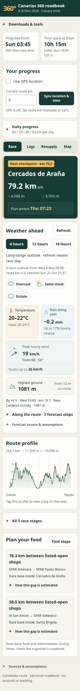

# Canarias 360 · Racer roadbook

A self-contained HTML roadbook using the 254.074 km candidate GPX from Gáldar to Tejeda. Open [`index.html`](index.html), or save it to your phone. The ordered route, profile, shop data and calculations work offline. Street tiles and external links need internet; GPS needs a secure browser context.



## During the race

The main views are **Race**, **Legs**, **Resupply** and **Map**. The race overview shows the next checkpoint, distance and climbing remaining, projected finish and time spare against the final limit. Route legs use readable cards instead of a wide table. Body and form text is 18px, controls have at least 48px touch targets, and supplementary information is folded away.

**Daily progress** is collapsed by default. Expand it to change the four net daily distances or open manual timing and delay settings. Notes, saved places, custom hours editing and JSON plan import/export have been removed. Previous browser settings migrate only the pacing and progress fields; old notes and hours overrides are not imported into the new state.

**Resupply** shows six stops at a time, in route order. Each stop leads with its name, distance ahead along the course, outward walking detour, plan arrival and opening status. Map and call are the main actions. **Hours & details** contains the source, weekly schedule, scenario window and separately labelled straight-line GPS distance. Search is visible; additional filters are collapsed with a summary of the current selection. Open details stay open when GPS refreshes.

Use **Downloads & tools** for a portable HTML with your current pace settings, the original GPX, section CSV, evidence data or printing. Printing includes the route legs and the next six matching resupply places. Settings and the last route kilometre are saved locally; the committed app contains no personal progress.

## Location and time

The global progress panel is available on every view. **Use GPS location** starts a browser location watch and updates your route kilometre when the fix is accurate and near the ordered GPX. **Centre on me** on the map uses the actual GPS fix, with an accuracy circle.

Tap **Sync location & time** to link both route progress and the current race clock in one action. It requests GPS if needed, waits for an accurate on-route position, sets elapsed race time from Wednesday's start, and enables ETA anchoring. New fixes and a 30-second foreground refresh keep the clock linked while GPS remains usable. Opening-hour checks and the finish margin use the updated ETAs. Before the start, it explicitly keeps the Wednesday 09:00 schedule; after the cutoff, it shows elapsed time and lateness without resetting the clock.

Poor accuracy, stale fixes, off-route positions and unresolved repeated passes do not overwrite the last verified progress/time anchor. At an ambiguous crossing, set an approximate route kilometre to choose the right pass. Switching GPS off freezes the last anchor and restores manual kilometre editing. Editing elapsed time or the anchoring checkbox ends automatic clock linkage; tap Sync to resume. Reopening the app retains the last anchor but never restarts tracking automatically. Browsers may pause GPS in background tabs.

GPS requires permission and HTTPS or localhost. Some mobile browsers block it in a downloaded HTML file; use the HTTPS-hosted app in that case. The app does not send GPS coordinates to a server or persist raw fixes. Straight-line proximity is not a walking route. The race clock relies on the device clock being correct.

## Race model

- Start: **Wednesday 4 November 2026, 09:00**, Atlantic/Canary (GMT during the race).
- Final limit: **101 hours**, Sunday 8 November at 14:00.
- Default net daily progress: **85 / 70 / 60 / 50 km**. Normal sleep, meals and base stops are already included.
- Default projection: **Sunday 03:45**, about **10h 15m spare**.
- Slower **80 / 65 / 55 / 45 km** scenario: about **Sunday 13:50**, only ten minutes spare.

Each 24-hour block allocates time using distance plus ascent effort while retaining exact daily kilometre quotas. The partial final day uses its proportion of the last quota; that quota repeats if more days are needed. Arrival windows use ±5 km on each daily target and are scenarios, not confidence intervals.

Shop arrivals include the estimated outward detour at 3 km/h plus a climb allowance. The finish model does not automatically add detours, waiting, shopping or rest beyond the normal daily allowance. Add unplanned time under **Extra delay**. Race-base services and intermediate closing times follow the official organiser roadbook; only the final 101-hour limit is modelled. Access is treated as resolved. This app does not change the candidate geometry.

## Evidence and elevation

There are 29 terrain legs, five checkpoint stages and 353 mapped places near the route. Of these places, 102 have published hours and 11 have directly checked operator schedules. POIs use the 25 October 2026 OpenStreetMap snapshot, spatially filtered against the candidate and its pedestrian graph. SPAR owner pages provide checked schedules and coordinates; an older generic Tejeda SPAR POI was suppressed as a probable duplicate of the current owner-listed store. Source records are in [`data/roadbook_data.json`](data/roadbook_data.json) and in the app's evidence download.

Published hours are checked for the arrival date, split sessions, overnight hours and Sundays. Conditional or seasonal expressions remain unknown when they cannot be evaluated conservatively. Published hours do not establish stock, kitchen service or one-off closures. Water-point operability is unverified. Fuel stations are counted as food only when a shop is separately mapped. Walking approaches use mapped ways to a venue's vicinity; the final entrance is not surveyed. Sparse data is not proof that no other service exists.

Elevation uses the candidate's Mapzen/AWS Skadi DEM samples, resampled every 25 m with Gaussian sigma 50 m. Section ascent/descent uses differences of one cumulative smoothed profile, reconciling to approximately **+11,939 / −10,996 m**. The source GPX checksum is verified on every build and the download preserves its full geometry.

## Build and test

There are no npm runtime dependencies. Python standard library builds the HTML; Node runs the engine and route-matching tests.

```sh
python3 scripts/build.py
npm test
python3 -m http.server 8787 --bind 127.0.0.1
```

With the server running, install Playwright and its browser dependencies, then run:

```sh
python3 tests/browser_test.py
python3 tests/mobile_controls_test.py --browsers chromium webkit
python3 tests/geolocation_browser_test.py
python3 tests/progress_sync_browser_test.py
```

The suites use system Chromium (`/usr/bin/chromium`, or `CHROMIUM_PATH` for mobile/GPS tests) and Playwright WebKit. External requests are blocked to check offline operation. Reports in `docs/` record:

- 18 engine/data tests and 18 route-matching/location lifecycle tests.
- 30 browser journey checks, including feature removal, state migration, collapsed settings, offline HTML reopen, keyboard navigation and byte-identical GPX download.
- 276 mobile UX checks across Chromium and WebKit at 320, 360, 390 and 430 CSS pixels, plus 844/932 landscape widths. Expanded numeric controls, filter text clipping, 48px targets, larger text and leg cards are checked.
- 44 browser Geolocation API checks for permission, actual-position maps, distances, weak/off-route fixes and manual fallback.
- 54 clock-sync checks with deterministic time and GPS callbacks, including before-start/after-limit behaviour, live updates, manual overrides, permission retry and reopening without auto-tracking.

These are browser emulation and simulated GPS checks, not physical-device or field accuracy tests. Representative screenshots are in `docs/screenshots/` and `docs/mobile-qa/`.

For GitHub Pages, select the `main` branch and repository root. No hosting account is required for the downloadable HTML.

## Attribution

- Map and POI data © [OpenStreetMap contributors](https://www.openstreetmap.org/copyright), ODbL 1.0; source queries and evidence are included with the data.
- Shop schedules: [SPAR Gran Canaria owner pages](https://spargrancanaria.es/tiendas/), linked individually in the app.
- DEM: Mapzen Terrain Tiles / AWS Skadi composite; [Joerd documentation](https://github.com/tilezen/joerd/tree/master/docs).
- Leaflet 1.9.4, BSD-2-Clause, bundled with its license in `vendor/`.
- Day/night markers: Astral island-centre sunrise/sunset calculations, not terrain-shadow or weather predictions.

## Trail Vision

Open **Map → Trail Vision** for a compass-driven first-person preview of the next 500 m. It uses the embedded GPX's actual bends and elevations, a dark cyan ribbon, 100 m markers and GPS route matching. Turn and tilt the phone to look around; no camera or video is used. Manual and route-following views are explicit alternatives when compass readings are unavailable.

Controls include 100 / 250 / 500 / 1,000 m look-ahead, vertical scale, Recenter, a progress hint, desktop simulation and local GPX preview loading. The renderer uses Canvas perspective geometry without a new dependency or WebGL requirement. The hosted app now caches its self-contained HTML for offline reloads; wait for offline readiness under Downloads & tools before leaving coverage.

Read [Trail Vision permissions, implementation and Android/iOS testing](docs/trail-vision.md) for north-reference limits, calibration guidance, battery decisions and field-check instructions. New automated suites are `node tests/vision.test.js`, `python3 tests/vision_browser_test.py` and `python3 tests/offline_browser_test.py`. Browser tests use simulated sensors, not physical hardware.

## Weather ahead

The **Race** view now includes **Weather ahead** above the route profile. Choose a **6-, 12- or 18-hour outlook** for the locations and elevations you are projected to reach. The compact summary shows temperature/feels-like range, approximate rain along the moving route, maximum hourly rain chance, wind/gusts and highest terrain. Expand **Along the route** for timed forecast stops, route kilometres, GPX heights and day/night conditions.

Forecasts come from [Open-Meteo](https://open-meteo.com/en/docs), with a separate GPX coordinate and supplied elevation for each projected hour. The existing fatigue/climbing pace curve is inverted to predict progress; extra delay holds position before movement resumes. During the race, the outlook starts at the current clock time and last entered route kilometre. Before the race it uses the planned arrival time at that kilometre, or a later explicit elapsed-time anchor. Use **Sync location & time** to keep progress current.

The app requests the whole 18-hour path in one batch, so changing views needs no new request. It refreshes when the Race view is visible, normally every 30 minutes, after pace/manual-progress changes, or after substantial GPS progress; **Refresh** updates it on demand. Model date coverage is limited to about 16 days and missing values remain unavailable. Longer-range outlooks are labelled. Coordinates/elevations sent to the provider are projected GPX positions, rather than raw GPS fixes.

Saved forecasts retain their original dates, route positions and fetch time. Offline forecasts are labelled; old data is marked stale and expired windows hide their numerical summary. **Save offline HTML** includes the latest loaded weather snapshot. The app does not substitute today's weather for unsupported race dates. Weather fields are model estimates: mountain microclimates, exposed-ridge winds and trail conditions can differ. Height-dependent downscaling does not create a terrain-resolving wind model.

Weather data © Open-Meteo, [CC BY 4.0](https://creativecommons.org/licenses/by/4.0/). Rain totals sum hourly estimates at the moving runner's projected positions, excluding the preceding hour at the starting point; they are approximate exposure estimates. The probability displayed is the maximum individual hourly rain chance, not a combined probability for the whole window. Highest terrain also examines intervening GPX profile heights, including crests between hourly forecast positions.

`weather.js` and `weather.css` are embedded by the existing build without dependencies or API keys. Run `node tests/weather.test.js` for projection, time/elevation, response parsing and summary tests; `python3 tests/weather_browser_test.py` checks Chromium/WebKit layouts, horizons, pace changes, midnight, failures and portable offline snapshots. Forecast API responses are mocked in deterministic browser tests; a separate live request verified the 19-location race forecast and elevation parameters. Evidence is recorded in `docs/weather-integration.json`.


The weather panel uses bundled SVG illustrations for clear skies, cloud, rain, snow, fog, ice and thunderstorms, with moon variants for clear/cloudy nights. Direction indicators point north-up toward the wind's source and pair with a sixteen-point compass label. The summary pairs direction with the strongest hourly wind sample; gust peaks are listed separately. Wind and gust speeds remain in km/h. Calm conditions show no prevailing direction, and missing data remains unavailable. Icons have adjacent text labels, work offline and require no additional requests.
