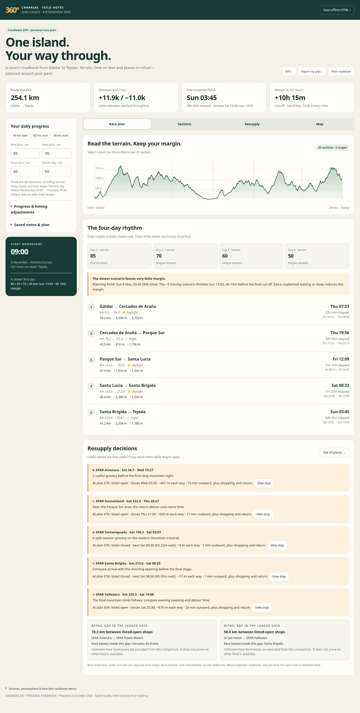

# Canarias 360 · Racer roadbook

A downloadable, self-contained HTML app based on the 254.074 km candidate GPX from Gáldar to Tejeda. It combines 29 terrain sections, five checkpoint stages, personal pacing and resupply opening windows.

**Open [`index.html`](index.html) in a browser**, or download it to your phone. The route, profile, shop data, notes and calculations work without a connection. Street-map tiles, calls and business websites require internet. All dependencies and the original GPX download are embedded in that HTML file.



## Your race plan

- Start: **Wednesday 4 November 2026, 09:00**, Atlantic/Canary.
- Final limit: **101 hours**, Sunday 8 November at 14:00.
- Default net daily progress: **85 / 70 / 60 / 50 km**, allowing for fatigue after the first day. These targets already include normal sleep, meals and race-base stops.
- Default projection: **Sunday 03:45**, about **10h 15m spare**.
- Slower **80 / 65 / 55 / 45 km** scenario: approximately **Sunday 13:50**, leaving only about ten minutes.

Each 24-hour block is distributed using distance plus ascent effort. Daily geographic quotas remain exact, rather than applying a constant kilometre-per-hour speed to every climb. The partial final day uses its proportion of the last daily quota. The last quota repeats if more than four days are needed.

Edit daily targets, add extra delay, or re-anchor future ETAs to your actual distance and elapsed time. The arrival window uses ±5 km on each daily target; it is a scenario range, not a statistical confidence interval.

## What is included

- Section distance, gain/loss, ending elevation, arrival time and day/night indication.
- Five checkpoint-stage summaries and final cut-off margin.
- **353 mapped places** near the route, including shops, bakeries, cafés, restaurants and water points. **102 have published hours; 11 operator schedules were checked directly.**
- Opening checks for the actual arrival date, including split sessions, overnight hours and Sunday closures. Conditional/seasonal expressions that cannot be evaluated conservatively stay unknown.
- Approximate walking detours along the mapped pedestrian network to each venue's vicinity; the final entrance is not surveyed.
- Opening status at your planning ETA and across the full arrival window, next opening/wait, source links and phone numbers where available.
- Filters by type, known hours, owner evidence, saved places, distance ahead and walking detour.
- Editable confirmed hours, personal notes, local saving, JSON plan import/export, portable HTML save, GPX download, section CSV and print layout.
- Offline route/map overlays, with optional online OSM street tiles.

Access is treated as resolved. This app uses the existing candidate course; it does not change its geometry.

## Using resupply information

"Listed open" means the stored weekly schedule covers the modelled arrival time. It does not confirm stock, kitchen service or a one-off closure. Restaurant opening hours do not establish kitchen hours. Unknown hours stay unknown. Water-point operability is unverified. Fuel stations without a separately established shop are not counted as food stops.

Shop ETAs include an estimated outward detour at 3 km/h plus a climb allowance. The finish model does **not** automatically add extra detours, queues, shopping or opening-time waits beyond your net daily targets; put additional time in **Extra delay ahead**. An opening after the final race limit is explicitly marked.

Race-base services and intermediate closing times follow the official event roadbook. Only the supplied final 101-hour limit is modelled here.

## Evidence and elevation

POIs come from an OpenStreetMap snapshot retrieved 25 October 2026, spatially filtered against the candidate track and its pedestrian graph. Operator SPAR pages provide current coordinates and weekly schedules for the checked stores. An older generic Tejeda SPAR POI was suppressed as a probable duplicate of the owner-listed store, whose current hours take precedence. Evidence and this decision are in [`data/roadbook_data.json`](data/roadbook_data.json), and can be downloaded from the app.

Opening and location evidence is attached to each place. Sparse map data is not proof that no other service exists. Operator hours are checked against source pages, not by telephone.

Elevation uses the candidate's original Mapzen/AWS Skadi DEM samples, resampled every 25 m with Gaussian sigma 50 m. Section ascent/descent uses differences of one cumulative smoothed profile, so section totals reconcile with approximately **+11,939 / −10,996 m**. This differs slightly from summing stages smoothed independently. Source GPX checksum is verified on every build; full point geometry is preserved on the map and in the GPX download.

## Build and test

No npm dependencies are required.

```sh
python3 scripts/build.py
node tests/engine.test.js
```

The generated `index.html` is deterministic and has no runtime fetch dependency. Python 3.12 and Node 24 were used. There are 18 engine/data tests covering exact daily quotas, fatigue/finish margins, progress anchoring, split and overnight hours, Sunday closure, unknown/seasonal rules, fuel-shop separation, route-axis integrity and reconciled section totals.

Browser QA uses Playwright with system Chromium. In one terminal, serve this repository:

```sh
python3 -m http.server 8787 --bind 127.0.0.1
```

Then, in another:

```sh
python3 -m pip install playwright
python3 tests/browser_test.py
```

The browser checks block all non-local requests to verify operation without external resources. They cover desktop/mobile layout, filters, notes, safe text handling, opening overrides, offline HTML export/reopen, interactive map/sections and byte-identical GPX download. Test summaries are in `docs/`.

### Phone form-control regression checks

The mobile layouts use two-column numeric rows, 16px input text, 48px input heights,
full-width resupply filters and separate preset-button rows. Numeric keyboards,
checkboxes and disclosure controls are styled consistently across browsers.

After serving the repository, run:

```sh
python3 -m playwright install webkit
python3 tests/mobile_controls_test.py --browsers chromium webkit
```

This tests Chromium and WebKit at 320, 360, 390 and 430 CSS pixels, plus 844- and 932-pixel landscape views, including opened
timing settings, long numeric values, typing into all eight number fields, filter
label clipping, touch targets and the edit dialog in a reduced-height viewport.
The 216 checks and per-browser screenshots are in `docs/mobile-controls-tests.json`
and `docs/mobile-qa/`. This is browser emulation rather than a physical-device test.
Playwright's normal system dependencies for the selected browsers are required.

To host with GitHub Pages, select `main` and the repository root in the repository's Pages settings. No hosting or external account is needed for the downloaded HTML.

## Data and software attribution

- Map and POI data © [OpenStreetMap contributors](https://www.openstreetmap.org/copyright), ODbL 1.0. Source queries and ordered place evidence are included with the data.
- Checked shop schedules and coordinates: [SPAR Gran Canaria store pages](https://spargrancanaria.es/tiendas/), linked individually in the app. Factual schedules are normalised to weekly patterns.
- DEM: Mapzen Terrain Tiles / AWS Skadi composite elevation tiles; [Joerd documentation](https://github.com/tilezen/joerd/tree/master/docs).
- Leaflet 1.9.4, BSD-2-Clause; bundled under `vendor/` with its license.
- Day/night markers: Astral calculation for the island centre, not terrain-shadow or weather predictions.

Settings and notes are stored only in your browser or your exported plan. The committed app contains no personal progress or notes.

## Current location and nearby resupply

Use **Use current location (GPS)** on either the Map or Resupply tab. Both toggles
control the same browser location watch. The browser asks for permission only
after you turn it on; tracking is not restored automatically after reopening the
app. **Centre on me** moves the map to the actual GPS fix, and a circle shows its
reported accuracy.

An accurate fix near the track updates **Current km** by projecting onto the
ordered GPX segments. The ahead filter then removes passed stops and each card
shows distance ahead along the route, distance including the outward shop
approach, and a separately labelled straight-line GPS distance. Straight-line
proximity is not a walking route. Existing search, type, detour and hours filters
continue to apply. Arrival times still use your editable race plan and its
existing progress/elapsed-time anchoring controls.

Poor accuracy, an old fix, an off-route position or an unresolved repeated pass
of the track does not overwrite progress. The actual/last GPS fix can still be
shown while the planner uses the existing Current km. At an ambiguous crossing,
enter an approximate kilometre to select the right pass. Switching GPS off clears
the watch and map overlays, restores manual editing and retains the last verified
route kilometre. Browsers can pause location updates in background tabs.

**Location needs browser permission and a secure context (HTTPS or localhost).**
Some mobile browsers block location in downloaded HTML files; use an HTTPS host
such as GitHub Pages in that case. Offline route/POI browsing still works without
GPS. No GPS coordinates are sent to an application server or saved in plan JSON
or browser storage. The matched route kilometre is saved locally with your plan.

`location.js` contains the segment projection and location-watch lifecycle.
`node tests/location.test.js` covers matching, ambiguous passes, permission
handling, stale/weak/off-route fixes and stopping/late callbacks. Browser checks
in `tests/geolocation_browser_test.py` use simulated fixes through Chromium and
WebKit's Geolocation API, including the synchronized switches, map markers,
distances, filtering and manual fallback. They are not a physical GPS accuracy
test. After serving the repository and installing the selected browsers, run:

```sh
node tests/location.test.js
python3 tests/geolocation_browser_test.py
```

Results are recorded in `docs/geolocation-browser-tests.json`.
